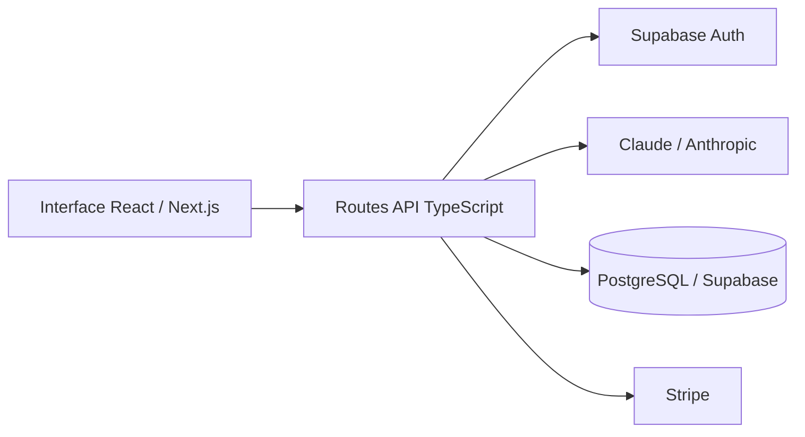

# Clipmap

**Du script aux scènes d’un montage vidéo, avec l’IA**

Clipmap aide à préparer un montage à partir d’un script : découpage en scènes et recherche de vidéos, images et sons adaptés. J’ai conçu et développé ce produit avec TypeScript, Next.js et Supabase.

Ce dépôt présente le produit et son architecture. Le code source reste privé.

## Parcours utilisateur

1. Saisir le script d’une vidéo.
2. Obtenir un découpage en scènes avec mots-clés et estimations de durée.
3. Rechercher les médias qui correspondent aux scènes.
4. Préparer le montage à partir des éléments sélectionnés.

## Mon rôle

Développement full stack : interface React, routes API Next.js, intégration de Claude, authentification Supabase, persistance PostgreSQL et paiements Stripe.

## Architecture

## Intégration IA

La route de découpage utilise Claude via le SDK Anthropic. Le script est transformé en scènes avec des mots-clés de recherche et une durée estimée. La réponse JSON est validée avant sauvegarde dans PostgreSQL.

## Fiabilité et contrôle des accès

- Authentification utilisateur avant l’appel à l’IA.
- Validation de la longueur du script.
- Limitation des requêtes par utilisateur et quotas d’usage.
- Délai maximal d’exécution pour les appels au modèle.
- Interface disponible en français et en anglais.

## Stack

| Couche | Technologies |
| --- | --- |
| Interface | React, Next.js App Router, TypeScript, Tailwind CSS |
| API | Routes serveur Next.js, TypeScript |
| IA | Claude, SDK Anthropic |
| Authentification et données | Supabase Auth, PostgreSQL |
| Paiements | Stripe |

## Consulter le produit

[Ouvrir Clipmap](https://clipmap.vercel.app)

Cette présentation documente les fonctionnalités développées. Elle ne fournit pas une version installable ; l’accès au service dépend de son état de déploiement.

---

Projet conçu et développé par [Jorian Gaurin](https://github.com/jgaurin) · [LinkedIn](https://www.linkedin.com/in/jorian-gaurin)
